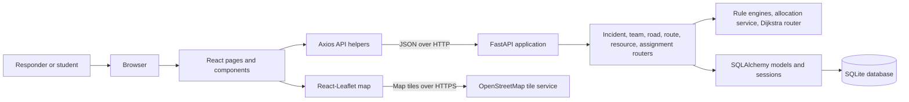

# RouteRescue – AI-Powered Emergency Response Coordination


RouteRescue is a college-project prototype for coordinating emergency reports, response teams, resources, and routes through a single web dashboard.

The project demonstrates how these tasks could be connected. Its incident analysis and road predictions use **deterministic rules and simulated inputs**. It is not a real emergency dispatch service, and its results must not be used as operational guidance.

## Table of contents

- [Project overview](#project-overview)
- [Problem statement](#problem-statement)
- [Proposed solution and objectives](#proposed-solution-and-objectives)
- [Technology stack](#technology-stack)
- [System architecture](#system-architecture)
- [Application modules](#application-modules)
- [Algorithms and implementation](#algorithms-and-implementation)
- [Project structure](#project-structure)
- [Database](#database)
- [Requirements](#requirements)
- [Installation and running](#installation-and-running)
- [API and Swagger documentation](#api-and-swagger-documentation)
- [Screenshots](#screenshots)
- [Example workflow](#example-workflow)
- [Current limitations](#current-limitations)
- [Future enhancements](#future-enhancements)
- [Conclusion](#conclusion)

## Project overview

| Item | Description |
|---|---|
| Project name | RouteRescue – AI-Powered Emergency Response Coordination |
| Project type | Full-stack web application and academic demonstration |
| Main users | Students or reviewers exploring emergency-coordination workflows |
| Frontend | React single-page application served by Vite |
| Backend | FastAPI REST API written in Python |
| Database | SQLite file accessed through SQLAlchemy |
| Map | Leaflet map with OpenStreetMap background tiles and a fixed demo road graph |

### Why we developed it

Emergency coordination can involve several connected decisions: recording what happened, understanding how urgent it may be, finding a suitable response team, checking available resources, and choosing a route. RouteRescue brings example versions of these steps into one place so they can be demonstrated and studied together.

## Problem statement

When incident information, team availability, supplies, and road conditions are kept in separate tools or records, it can be difficult to build a shared picture of an emergency. Decisions may also need to change when a road becomes inaccessible.

RouteRescue models this coordination challenge using a small, simulated road network around Mysuru. It demonstrates the flow of information between a report form, analysis rules, a database, and a map-based dashboard.

## Proposed solution and objectives

RouteRescue provides a React command-center interface connected to a FastAPI backend. The backend stores incident, team, road, assignment, and resource-allocation records in SQLite.

The project objectives are to:

1. Submit and review emergency reports.
2. Extract useful incident details from report text using simple NLP-style rules.
3. Assign a demonstration severity using an explainable scoring rule.
4. Estimate road accessibility from supplied or seeded conditions.
5. Match active incidents with available emergency teams.
6. Allocate available inventory and record the reservation.
7. Calculate a lower-cost route over a graph and recalculate after a road closure.
8. Show the data and routes in a GIS-style dashboard.

## Technology stack

### Backend packages

These package versions are pinned in `backend/requirements.txt`.

| Package | Declared version | Why it is used here |
|---|---|---|
| **FastAPI** | `0.111.0` | Defines HTTP endpoints and produces the interactive Swagger/OpenAPI documentation. |
| **Uvicorn** | `0.29.0` | Runs the FastAPI application during local development. |
| **Pydantic** | `2.7.1` | Defines request/response schemas and validates fields on endpoints that use those schemas. |
| **SQLAlchemy** | `2.0.30` | Maps Python model classes to database tables and manages database sessions and queries. |
| **python-multipart** | `0.0.9` | Installed support package; the current API routes do not implement file uploads or form-data endpoints. |
| **aiofiles** | `23.2.1` | Installed support package; the current source does not implement asynchronous file storage. |
| **httpx** | `0.27.0` | Installed HTTP client package; the current API routes do not use it to call external services. |

### Frontend packages

`package.json` declares semver ranges (the `^` allows compatible releases); `package-lock.json` records the versions installed by `npm ci`.

| Package | `package.json` range | `package-lock.json` resolved version | Why it is used here |
|---|---:|---:|---|
| **React** | `^18.3.1` | `18.3.1` | Builds the interactive pages from reusable UI components. |
| **React DOM** | `^18.3.1` | `18.3.1` | Renders the React application into the browser document. |
| **React Router DOM** | `^6.26.2` | `6.30.6` | Connects the nine application pages to browser paths without full-page reloads. |
| **Axios** | `^1.7.7` | `1.21.1` | Sends JSON HTTP requests from the browser to FastAPI. |
| **Leaflet** | `^1.9.4` | `1.9.4` | Provides the interactive map layer and map controls. |
| **React-Leaflet** | `^4.2.1` | `4.2.1` | Connects Leaflet maps and layers to React components. |
| **Recharts** | `^2.12.7` | `2.15.4` | Renders charts from data returned by the backend. |
| **Lucide React** | `^0.447.0` | `0.447.0` | Supplies icons used in navigation, buttons, and dashboard sections. |
| **Vite** | `^5.4.8` | `5.4.21` | Starts the local development server and creates the production frontend bundle. |
| **@vitejs/plugin-react** | `^4.3.1` | `4.7.0` | Enables React/JSX support in the Vite configuration. |

### Runtime and other technologies

| Technology | Where it is used | Why it is used here |
|---|---|---|
| **Python 3.12** | Backend runtime | Recommended and tested in the current environment as Python 3.12.10. The repository does not pin or enforce a Python version. |
| **SQLite** | Database | Stores project records in a local file; no separate database server is needed. The project does not pin a separate SQLite version. |
| **OpenStreetMap tiles** | Map background | Supplies the map tiles displayed beneath RouteRescue’s simulated graph. Tile requests require an internet connection and include OpenStreetMap attribution. |
| **CSS** | Frontend styling | `index.css` and `command-center.css` style the application. The project does not use a CSS utility framework. |
| **Python standard library** | Backend algorithms | `re` handles text patterns, `heapq` supports Dijkstra’s priority queue, `math` supports geographic distance calculations, and `json` handles JSON stored in text fields. |

The map uses Leaflet and React-Leaflet to render the interactive map, road lines, incident/team markers, route lines, popups, and zoom controls. SQLite is accessed through Python’s SQLite driver via SQLAlchemy.

## System architecture

The browser renders the React application. Its Axios helpers call the FastAPI service directly. Endpoints that declare Pydantic request schemas receive model-based validation; other handlers accept dictionary request bodies and may apply narrower manual checks, so request validation is not identical across all endpoints. Routers call Python services or algorithms and use SQLAlchemy to read or update the SQLite file. The browser requests OpenStreetMap tiles separately from the map tile service.



### Request and data flow

1. A page calls a helper in `frontend/src/services/api.js`.
2. Axios sends a request to `http://127.0.0.1:8000`.
3. A FastAPI router applies its declared schema validation or endpoint-specific body handling, then runs the required rule or service.
4. SQLAlchemy reads or writes the corresponding SQLite records.
5. FastAPI returns JSON, and React updates the page.

The API base URL is hard-coded in `frontend/src/services/api.js`. Vite also defines an `/api` proxy, but the current Axios helpers do not use that proxy.

## Application modules

The nine routes are registered in `frontend/src/App.jsx` and linked from the sidebar.

| Module | Frontend route | What it does |
|---|---|---|
| **Dashboard / Command Center** | `/` | Loads incidents, teams, roads, assignments, network data, and resource summary from the API. Shows current counts, charts, recent reports, team/road summaries, and map layers. |
| **Report Emergency** | `/report` | Collects report information and submits it to `POST /incidents/`. The backend stores the incident with extracted data and a rule-based severity. |
| **Incident Management** | `/incidents` | Lists and filters incidents, displays severity and report information, changes an incident’s status, and requests re-analysis. |
| **Road Accessibility** | `/roads` | Shows road status and simulated risk information, calls the accessibility predictor, and lets a user update road conditions. |
| **Emergency Teams** | `/teams` | Lists team type, status, location, and the inventory returned by the API. |
| **Team Assignment** | `/assignments` | Lists saved assignments and runs the automatic assignment workflow for eligible active incidents. |
| **Route Optimization** | `/routes` | Selects a team and incident, requests a weighted graph route, and displays its distance, time estimate, risk notices, and map line. |
| **Resource Allocation** | `/resources` | Displays current team inventory and saved allocations, and can request allocation for eligible incidents. |
| **Dynamic Route Updates** | `/dynamic-routes` | Selects a saved assignment and one of its road segments, marks the road blocked, recalculates the route, and compares the old and new paths. Road changes persist until explicitly changed again. |

## Algorithms and implementation

The project’s “AI” behavior is made from hand-written rules. There is **no trained machine-learning model, LLM integration, or external prediction service** in the inspected source.

### Dijkstra’s shortest-path algorithm

`backend/algorithms/graph_router.py` defines 13 named Mysuru-area nodes and 20 fixed, undirected road edges. Each node has a hard-coded latitude and longitude; each edge has a fixed distance and road ID.

Before routing, the backend finds the graph nodes nearest to the team and incident coordinates using the Haversine formula. **Haversine** is a way to estimate straight-line distance between two latitude/longitude points.

Dijkstra’s algorithm then explores the graph using the lowest accumulated edge cost. The edge cost is:

```text
edge cost = road distance × accessibility multiplier × traffic multiplier
```

| Condition | Multiplier |
|---|---:|
| Accessible | 1.0 |
| Partial | 1.6 |
| High risk | 2.8 |
| Blocked | Not traversable (infinite cost) |
| Low traffic | 1.0 |
| Moderate traffic | 1.3 |
| Heavy traffic | 1.7 |
| Gridlock | 2.5 |

The API reports graph distance, a weighted cost, risk notices for partial/high-risk roads, and an estimated duration using a fixed speed of 40 km/h. Weather, flood risk, and historical risk do **not** directly change route edge costs. This is a graph demonstration, not turn-by-turn navigation.

### NLP-style incident information extraction

`backend/ai_modules/nlp_extractor.py` uses regular expressions, a limited number-word conversion list, and hard-coded keyword lists. It attempts to extract:

- Incident type from words such as “collision,” “flood,” or “fire.”
- A location from a fixed list of place names.
- Numbers of injured, trapped, or affected people when they match supported patterns.
- Severity keywords and hints.
- A heuristic confidence value.

This is not a general language-understanding model. The location list is limited, confidence is not calibrated, and keyword matching can misread negation (for example, a mention of “trapped” may be detected even when the report says nobody is trapped). Extracted values are saved as JSON text in `incidents.nlp_extracted`; manual incident fields remain separate.

### Rule-based severity classification

`backend/ai_modules/severity_classifier.py` adds points based on the submitted incident type, counts, and selected extracted keywords.

| Factor | Points |
|---|---|
| Flood or fire | +4 |
| Accident or medical emergency | +3 |
| Other or unknown type | +1 |
| One or more people trapped | +6 |
| 1–4 injuries / 5–9 injuries / 10+ injuries | +2 / +4 / +5 |
| 5+ / 10+ / 20+ / 50+ affected people | +1 / +2 / +3 / +4 |
| Critical keyword / selected high-severity keyword | +3 / +2 |

The result is `critical` at 10 or more points, `high` at 7 or more, `medium` at 4 or more, and otherwise `low`. The score is a demonstration heuristic—not medical triage or a validated emergency-severity measure.

### Road accessibility prediction

`backend/ai_modules/road_predictor.py` adds points from supplied weather and traffic values, flood risk, half of historical risk, and an optional closure flag.

| Input | Points added |
|---|---:|
| Weather | Clear 0; cloudy 1; rainy 3; stormy 6; foggy 2 |
| Traffic | Low 0; moderate 2; heavy 5; gridlock 9 |
| Flood risk | Supplied value |
| Historical risk | Supplied value × 0.5 |
| Reported closure | +15 |

The resulting score maps to `accessible` (0–3), `partial` (>3–7), `high_risk` (>7–12), or `blocked` (>12). The input is not checked against live observations. The API returns the score, factor contributions, recommendation, and calculation time.

### Team assignment

`backend/services/team_assigner.py` filters teams to those marked `available`, then scores each candidate using:

- Incident/team-type match: 15 points for the preferred type, 8 for another listed suitable type.
- Straight-line proximity: `max(0, 10 - 2 × distance_km)`.
- Capacity: up to 5 points.
- Severity boost: critical 10, high 5, medium 2, low 0.

The highest-scoring team is selected and the response includes reasons. The automatic assignment endpoint stores an assignment and calculated route, marks the team busy, and records the team on the incident. The scoring does not use inventory or route travel time.

### Resource allocation

`backend/services/resource_allocator.py` sorts eligible active incidents by severity, applies team-type preferences, and uses resource templates for each team type. It reserves no more than the quantities currently recorded in the chosen team’s inventory, decrements those quantities, and uses each team at most once in one allocation run.

`POST /resources/allocate` skips incidents that already have any allocation record. It persists the new allocations and updated inventory. This is a simple demonstration allocator: it does not split an incident’s needs across several teams, maintain a separate reservation ledger, or provide a concurrency-safe stock transaction. The allocation endpoint does not itself mark a team busy.

### Dynamic route recalculation

The Dynamic Route Updates page first saves the selected road’s blocked condition using `PUT /roads/{road_id}/condition`. It then calls `POST /routes/recalculate`, which reads current road accessibility and traffic, runs Dijkstra again, and saves the new route and reason to the existing assignment.

The road update is persistent; the page does not automatically restore the road’s previous condition. This workflow should only use simulated data, and any test closure must be deliberately restored.

## Project structure

This tree shows the important project files. Generated environments, `node_modules`, and Vite’s `dist` folder are omitted.

```text
RouteRescue/
├── .gitignore
├── README.md
├── ROUTERESCUE_HANDOVER.md
├── backend/
│   ├── ai_modules/
│   │   ├── nlp_extractor.py
│   │   ├── road_predictor.py
│   │   └── severity_classifier.py
│   ├── algorithms/
│   │   └── graph_router.py
│   ├── data/
│   │   └── sample_data.py
│   ├── routers/
│   │   ├── assignments.py
│   │   ├── incidents.py
│   │   ├── resources.py
│   │   ├── roads.py
│   │   ├── routes_router.py
│   │   └── teams.py
│   ├── services/
│   │   ├── resource_allocator.py
│   │   └── team_assigner.py
│   ├── database.py
│   ├── main.py
│   ├── models.py
│   ├── requirements.txt
│   ├── routerescue.db
│   └── schemas.py
└── frontend/
    ├── src/
    │   ├── components/
    │   │   ├── RouteMap.jsx
    │   │   ├── Sidebar.jsx
    │   │   └── ui.jsx
    │   ├── pages/
    │   │   ├── Dashboard.jsx
    │   │   ├── DynamicRouteUpdates.jsx
    │   │   ├── EmergencyTeams.jsx
    │   │   ├── IncidentManagement.jsx
    │   │   ├── ReportEmergency.jsx
    │   │   ├── ResourceAllocation.jsx
    │   │   ├── RoadAccessibility.jsx
    │   │   ├── RouteOptimization.jsx
    │   │   └── TeamAssignment.jsx
    │   ├── services/
    │   │   └── api.js
    │   ├── styles/
    │   │   ├── command-center.css
    │   │   └── index.css
    │   ├── App.jsx
    │   └── main.jsx
    ├── index.html
    ├── package.json
    ├── package-lock.json
    └── vite.config.js
```

### Important files

| File | Role |
|---|---|
| `backend/main.py` | Creates the FastAPI application, initializes the database and sample data at startup, enables CORS, and registers the routers. |
| `backend/database.py` | Creates the SQLite engine and SQLAlchemy sessions. |
| `backend/models.py` | Defines the five database models. |
| `backend/schemas.py` | Defines Pydantic request/response data shapes. |
| `backend/data/sample_data.py` | Adds initial teams, roads, and three sample incidents when the database has no emergency teams. |
| `frontend/src/App.jsx` | Registers the nine frontend routes and the shared application layout. |
| `frontend/src/services/api.js` | Defines the Axios instance and endpoint helpers. |
| `frontend/src/components/RouteMap.jsx` | Draws the graph, markers, and routes on Leaflet. |
| `frontend/src/components/ui.jsx` | Contains shared dashboard and form UI components. |
| `frontend/src/styles/command-center.css` | Contains the command-center theme and layout styles. |
| `frontend/vite.config.js` | Configures Vite’s development server on port 3000. |

The local `backend` folder may also contain ignored database backup files. They are not used by the application or included in this project tree; do not treat an older backup as a replacement for the active database without comparing its records first.

## Database

The active database is `backend/routerescue.db`. SQLAlchemy uses the relative URL `sqlite:///./routerescue.db`, so the backend must be started with `backend` as its current directory. Starting from the repository root may create or use a different file.

SQLite is a file-based database. SQLAlchemy maps the Python classes in `backend/models.py` to these tables:

| Table | Main information |
|---|---|
| `incidents` | Title, description, incident type, location and coordinates, affected/injured/trapped counts, severity, status, extracted NLP JSON, and assigned team ID. |
| `emergency_teams` | Team name/type, location and coordinates, availability, capacity, and inventory stored as JSON text. |
| `roads` | Road name and graph endpoints, distance and base time, weather/traffic values, flood and historical risk, accessibility, risk score, and last update. |
| `assignments` | Incident/team IDs, saved route JSON, active status, assignment time, and reason. Foreign keys reference `incidents` and `emergency_teams`. |
| `resource_allocations` | Incident/team IDs, allocated-resource JSON, priority, reason, and creation time. Foreign keys reference `incidents` and `emergency_teams`. |

`incidents.assigned_team_id` is not declared as a database foreign key. Road rows are not linked to another table by a foreign key. JSON values such as inventory and route data are stored as text rather than separate normalized tables.

### Data currently in the workspace database

At the time this README was prepared, the current workspace database contained 4 incidents, 5 emergency teams, 20 roads, 4 assignments, and 4 resource allocations. Startup seeding creates 5 teams, 20 roads, and 3 initial incidents **only when there are no emergency-team rows**. The seed function returns early if it finds any team; it does not repair an incomplete database.

Some existing allocation-history rows do not match the teams’ currently listed inventory: Allocation 1 includes oxygen tanks not listed for Team 1; Allocation 2 includes water purifiers not listed for Team 5; Allocation 4 lists 5 medical kits when Team 2 has 4, and includes a defibrillator not listed for Team 2. Allocation 3 matches Team 3’s listed fire hoses, foam canisters, and rescue tools. These records are part of the current demo database and should be reviewed before changing inventory or allocation history.

**Database safety:** back up `backend/routerescue.db` before any manual write or test that changes records. Do not replace it wholesale with an older backup without understanding what records would change.

## Requirements

- Windows PowerShell (commands below use PowerShell syntax).
- Python **3.12 is recommended**; the current environment was tested with Python 3.12.10. The repository does not pin or enforce a Python version.
- Node.js and npm. The inspected environment used Node.js v24.21.0 and npm 11.19.0; the project manifest does not pin a Node.js engine version.
- Git, to clone the repository.
- Internet access to install npm packages and display OpenStreetMap tiles.

## Installation and running

Run the backend and frontend in **two separate PowerShell terminals**.

### 1. Get the project

Clone the repository, then change to the project folder:

```powershell
git clone https://github.com/diya-dechamma/RouteRescue.git
Set-Location .\RouteRescue
```

The repository is private; GitHub access is required to clone it.

### 2. Set up and start the backend

From the project root, check Python 3.12 and create the backend virtual environment:

```powershell
py -3.12 --version
Set-Location .\backend
py -3.12 -m venv venv
.\venv\Scripts\Activate.ps1
python -m pip install --upgrade pip
pip install -r requirements.txt
python -m uvicorn main:app --reload --host 127.0.0.1 --port 8000
```

The virtual environment is local and is not part of the source code. If PowerShell prevents environment activation, install the requirements and run Uvicorn through the environment’s interpreter instead:

```powershell
# Run these commands in the backend terminal, which is already in the backend folder.
.\venv\Scripts\python.exe -m pip install --upgrade pip
.\venv\Scripts\python.exe -m pip install -r requirements.txt
.\venv\Scripts\python.exe -m uvicorn main:app --reload --host 127.0.0.1 --port 8000
```

Keep the backend terminal open. During startup, the application creates any missing tables and calls the sample-data function. The current workspace database is already populated, so the seeder returns early when it sees existing teams.

### 3. Install and start the frontend

Open a second PowerShell terminal from the project root:

```powershell
Set-Location .\frontend
npm ci
npm run dev -- --host 127.0.0.1 --port 3000
```

`npm ci` installs the exact dependency tree recorded in `package-lock.json`.

### 4. Open the application

| Service | URL |
|---|---|
| React frontend | [http://127.0.0.1:3000](http://127.0.0.1:3000) |
| Backend health | [http://127.0.0.1:8000/health](http://127.0.0.1:8000/health) |
| Swagger API documentation | [http://127.0.0.1:8000/docs](http://127.0.0.1:8000/docs) |
| OpenAPI JSON | [http://127.0.0.1:8000/openapi.json](http://127.0.0.1:8000/openapi.json) |

### Production frontend build

From `frontend`:

```powershell
npm run build
```

Vite writes the production files to `frontend/dist/`. A previously verified production build succeeded, with an advisory that the main JavaScript bundle is larger than 500 kB.

## API and Swagger documentation

The API base URL is `http://127.0.0.1:8000`. Open Swagger at [`/docs`](http://127.0.0.1:8000/docs) while the backend is running to inspect request fields, response shapes, and try endpoints.

| Method | Path | Purpose |
|---|---|---|
| `GET` | `/health` | Check that the backend is running. |
| `POST` | `/incidents/` | Create an incident and run extraction/severity rules. |
| `GET` | `/incidents/` | List incidents; optional filters include incident type, severity, and status. |
| `GET` | `/incidents/{incident_id}` | Get one incident. |
| `PUT` | `/incidents/{incident_id}/status` | Change an incident to active, pending, or resolved. |
| `POST` | `/incidents/{incident_id}/analyze` | Re-run extraction/classification and return the severity reasons. |
| `GET` | `/teams/` | List emergency teams. |
| `GET` | `/teams/available` | List available teams. |
| `POST` | `/teams/` | Create a team. |
| `PUT` | `/teams/{team_id}` | Update a team using the `TeamCreate` request schema; `name` and `team_type` are required, so this is not a general partial-update endpoint. |
| `PUT` | `/teams/{team_id}/availability` | Change team availability. |
| `POST` | `/teams/assign` | Set a team busy and update the incident’s assigned-team ID. This endpoint does not create a full assignment or route record. |
| `GET` | `/assignments/` | List saved assignments. |
| `GET` | `/assignments/{assignment_id}` | Get one assignment. |
| `POST` | `/assignments/auto-assign` | Automatically match available teams to active, unassigned incidents and save assignments/routes. |
| `GET` | `/roads/` | List road conditions. |
| `GET` | `/roads/network` | Return the fixed graph nodes, coordinates, and edges. |
| `PUT` | `/roads/{road_id}/condition` | Update a road’s conditions and/or accessibility. |
| `POST` | `/roads/predict` | Return a deterministic accessibility estimate from supplied inputs. |
| `POST` | `/routes/optimize` | Calculate a route for a team and incident; this endpoint does not save it. |
| `POST` | `/routes/recalculate` | Recalculate and save a route to an existing assignment. |
| `GET` | `/routes/assignment/{assignment_id}` | Get the saved route for an assignment. |
| `GET` | `/resources/allocations` | List saved resource-allocation records. |
| `POST` | `/resources/allocate` | Allocate inventory to eligible incidents. |
| `GET` | `/resources/summary` | Return incident, team, and allocation counts. |

### Example requests

Create a clearly labelled demo incident with `POST /incidents/`:

```json
{
  "title": "Demo road accident",
  "description": "Simulated collision near a Mysuru landmark; one person injured.",
  "incident_type": "accident",
  "location": "Mysuru",
  "lat": 12.2958,
  "lng": 76.6394,
  "affected_people": 1,
  "injuries": 1,
  "trapped": 0
}
```

Request a route with `POST /routes/optimize`:

```json
{
  "team_id": 1,
  "incident_id": 1
}
```

Use IDs that exist in your local database. These are example shapes, not live incident information.

## Screenshots

Replace each placeholder with a screenshot when one is available. Screenshots should use demo data and must not show private information.

> **Dashboard screenshot placeholder:** Add the Command Center dashboard here.

> **Incident report screenshot placeholder:** Add the Report Emergency form and its result here.

> **Road map screenshot placeholder:** Add the Road Accessibility map and road-status view here.

> **Dynamic routes screenshot placeholder:** Add the previous-route and recalculated-route comparison here.

## Example workflow

This example describes the local demonstration flow, not a real emergency response:

1. A user enters an incident title, description, type, location, and available counts on **Report Emergency**.
2. The browser sends the report to `POST /incidents/`. The backend stores the submitted fields, extracts matching text patterns, applies the severity scoring rules, and returns the saved incident.
3. The dashboard reloads data from the backend and includes the new report in its summaries and recent-incident list.
4. On **Team Assignment**, the user runs automatic assignment. The backend considers available teams, calculates suitability scores, chooses the highest-scoring candidate, and stores an assignment with a calculated route.
5. **Resource Allocation** is a separate action. It skips incidents that already have an allocation, selects a team with usable inventory, records the reserved quantities, and updates the team’s stored inventory.
6. On **Route Optimization**, a user can request a weighted route for a team and incident. The result is displayed but not saved by this endpoint.
7. For a route-change demonstration, **Dynamic Route Updates** can mark a road on an assignment’s route as blocked and request a recalculation. The backend saves the updated route on that assignment. The road remains blocked until someone deliberately changes its condition.

All map-network geometry and predictions in this workflow are simulated. Do not use the example for dispatch or safety decisions.

## Current limitations

- **No trained AI model:** incident extraction, severity, team scoring, road prediction, and allocation are deterministic rules.
- **No live data integrations:** no confirmed live weather, traffic, flood, or dispatch provider is connected. Road conditions and prediction inputs are seeded or supplied through the demo.
- **Approximate map geometry:** graph edges are straight lines between fixed nodes, not real street-centerline geometry. OpenStreetMap supplies the background tiles only.
- **Simplified routing:** travel time uses a fixed 40 km/h speed. Route costs use accessibility and traffic, but not weather, flood risk, or historical risk.
- **NLP limitations:** the location vocabulary is small, number patterns are limited, and keyword matching does not reliably understand negation.
- **Unstored report field:** the Report Emergency form includes an “Additional Information” field, but the backend incident schema does not define or persist it.
- **Severity is not operational guidance:** the score is a simple rule engine and is not clinically or operationally validated.
- **Inventory history needs review:** several existing allocation records do not match the current team inventory listed above. The allocator limits new reservations to current stock, but it does not reconcile old rows.
- **Allocation is not a full stock ledger:** allocations are not split among several teams, and the endpoint does not mark a team busy. Existing allocation records prevent repeat allocation for that incident.
- **Team suitability is simplified:** automatic assignment does not use inventory, live travel time, or route-aware scoring.
- **Team inventory editing is limited:** the team registration form does not provide an inventory editor, so a newly registered team may have no stock recorded.
- **Road changes persist:** the dynamic-route page does not restore a blocked road automatically.
- **No authentication or authorization:** CORS allows all origins in the current backend configuration. Do not expose the development service publicly.
- **Local API configuration:** the Axios base URL is hard-coded to `http://127.0.0.1:8000`; no environment-based API URL is configured.
- **Testing/build notes:** there is no maintained backend test directory or frontend `test` script. A previously verified Vite build succeeded but warned that the main bundle exceeded 500 kB.

## Future enhancements

1. Add automated backend tests using an isolated temporary database, plus frontend/API workflow tests.
2. Improve NLP with negation-aware parsing and test it against varied reports; keep human review in the workflow.
3. Clarify inventory semantics and add a transaction-safe reservation ledger with a reconciliation process for historical allocations.
4. Add team inventory editing and make assignment/allocation availability behavior consistent.
5. Make the road-closure demonstration safer by recording the prior condition and offering an explicit restore action.
6. Configure the API URL through environment-based settings and restrict CORS before any deployment.
7. If suitable data sources become available, integrate weather/traffic services with timestamps, provenance, failure handling, and clear separation from simulated data.
8. Replace straight-line graph segments with appropriate licensed road geometry if accurate map routing becomes part of the project scope.
9. Reduce frontend bundle size through code splitting and a review of large dependencies.

## Conclusion

RouteRescue is a full-stack academic prototype that connects incident reporting, deterministic analysis, team assignment, resource allocation, graph-based route calculation, and interactive maps. Its purpose is to demonstrate how these parts can work together in a web application.

It is **not** a production emergency-response platform. Its network and predictions are simulated, and its rules and resource history have known limitations. Keep those boundaries clear when demonstrating, extending, or describing the project.
